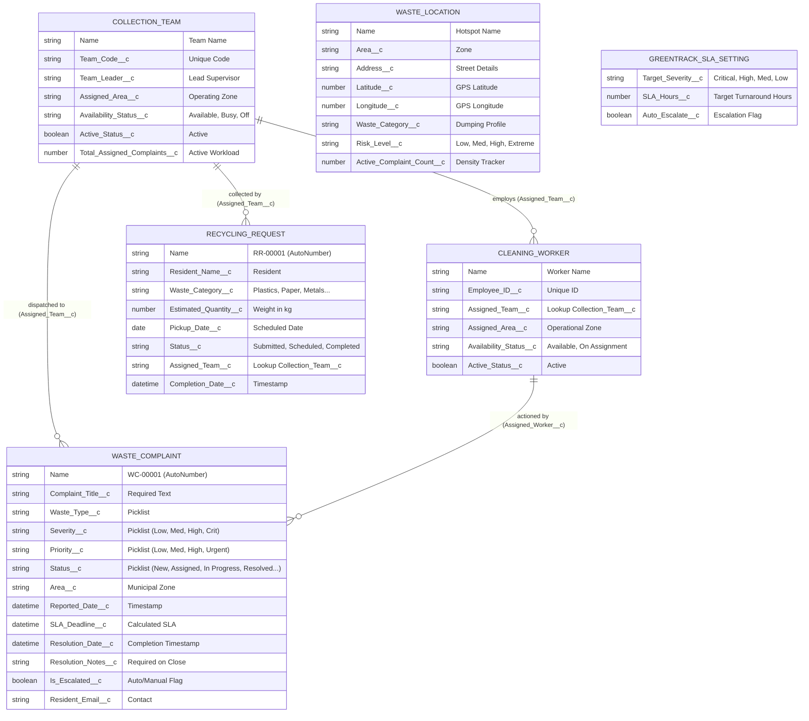

# GreenTrack Data Model & Entity-Relationship Architecture

## 1. Entity-Relationship Overview

## 2. Object Dictionary & Relationships

### A. Waste Complaint (`Waste_Complaint__c`)
* **Primary Key**: `Name` (Auto Number: `WC-{00000}`)
* **Assigned Team**: Lookup relationship to `Collection_Team__c`. Enables municipal routing and workload rollup.
* **Assigned Worker**: Lookup relationship to `Cleaning_Worker__c`. Enables field accountability and task attribution.
* **Audit & SLAs**: `Reported_Date__c`, `SLA_Deadline__c`, `Resolution_Date__c`, `Is_Escalated__c`.

### B. Collection Team (`Collection_Team__c`)
* **Primary Key**: `Name` (Text)
* **Unique External Identifier**: `Team_Code__c`
* **Workload Tracker**: `Total_Assigned_Complaints__c` tracks open non-resolved complaints automatically via Apex trigger handlers to prevent overloading.

### C. Cleaning Worker (`Cleaning_Worker__c`)
* **Primary Key**: `Name` (Text)
* **Unique External Identifier**: `Employee_ID__c`
* **Team Membership**: Lookup to `Collection_Team__c`.

### D. Recycling Request (`Recycling_Request__c`)
* **Primary Key**: `Name` (Auto Number: `RR-{00000}`)
* **Assigned Team**: Lookup to `Collection_Team__c` for bulk collection scheduling.

### E. Waste Location (`Waste_Location__c`)
* Monitors chronic dumping locations, public community bin overflow points, and GPS mapping coordinates.

### F. GreenTrack SLA Setting (`GreenTrack_SLA_Setting__mdt`)
* Configurable metadata driving SLA turnaround hours (Critical: 6h, High: 24h, Medium: 48h, Low: 72h) without hardcoded code values.
